
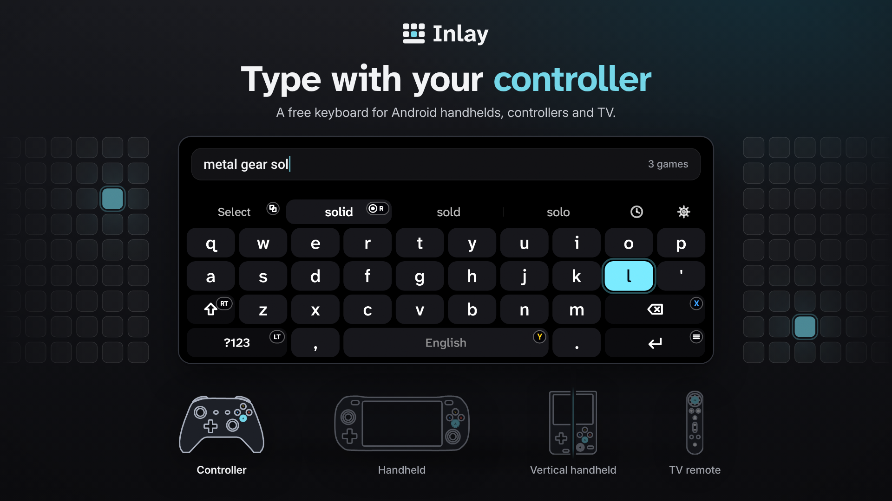

  
  
  
  

  
  &nbsp;
  

  <a href="#install">Install</a> · <a href="#features">Features</a> · <a href="#controls">Controls</a> · <a href="#tested-on">Tested on</a> · <a href="CHANGELOG.md">Changelog</a> · <a href="../../issues/new/choose">Report a problem</a>

 

Inlay is a keyboard you drive with the controller, not your thumbs on the glass. Move with the D-pad or stick, press A to type, and never reach for the touchscreen again. It's made for handhelds like the AYN Odin and Retroid Pocket, and works on any Android device with a gamepad connected.

Free and open source. No ads, no tracking, no internet permission.

<a href="https://youtu.be/9xe894Hsr6M"><b>▶ Watch the full video (1:22)</b></a> · <a href="docs/images/demo.gif">A real screen recording from my Odin 2 Portal</a>

The animation above is drawn from the app's real layouts, colours and sizes.

 

## What it looks like

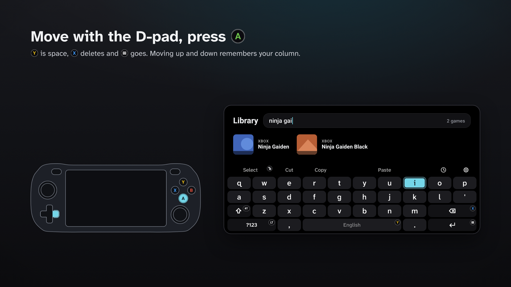

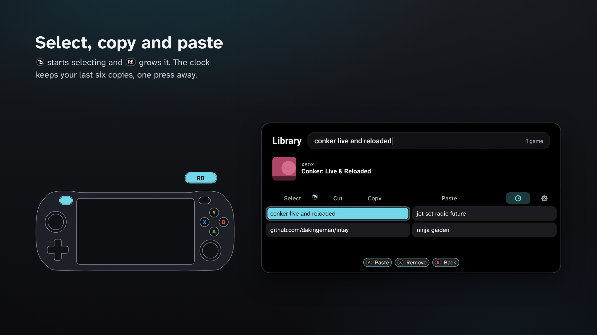

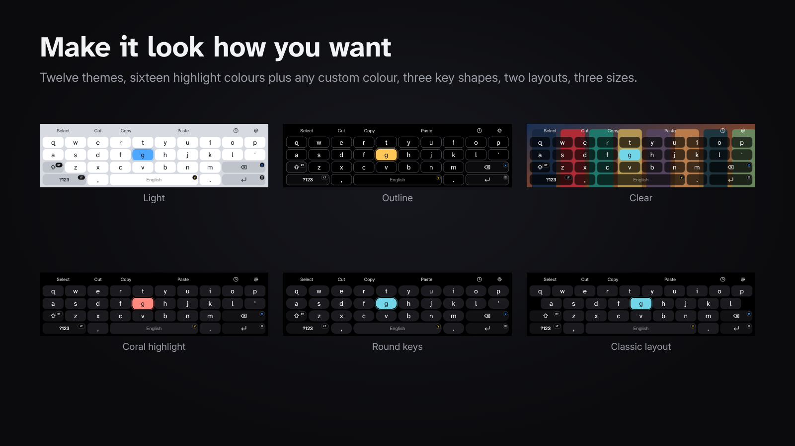

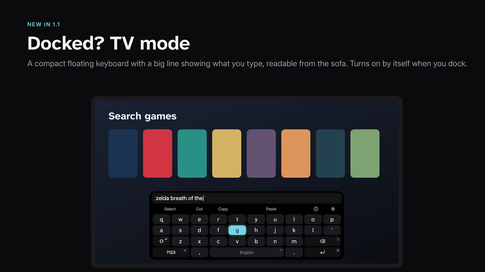

<b>See all 13 screens</b>

 

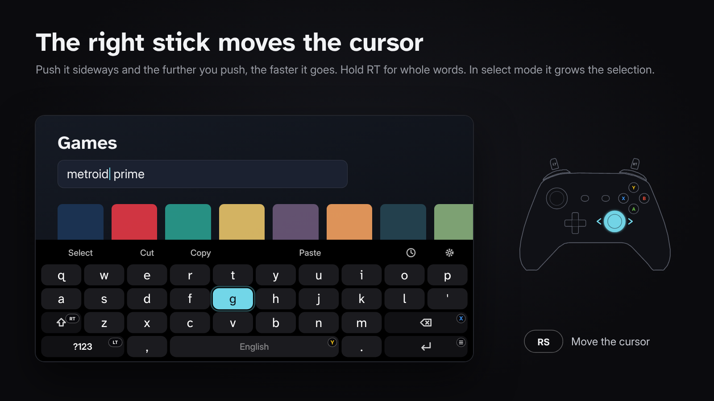

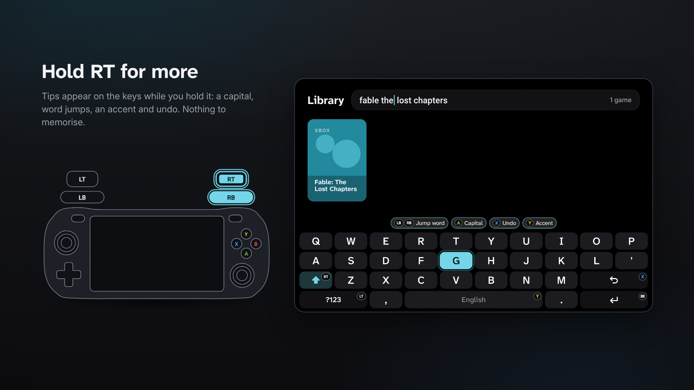

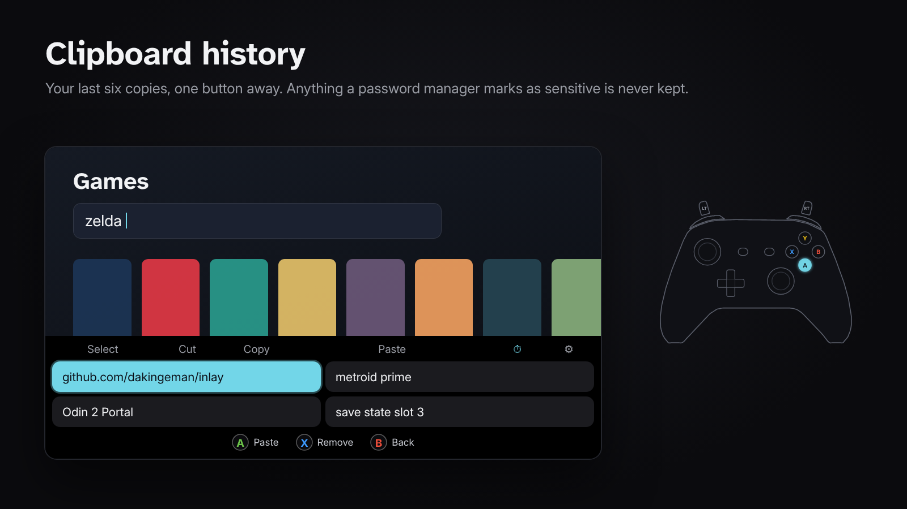

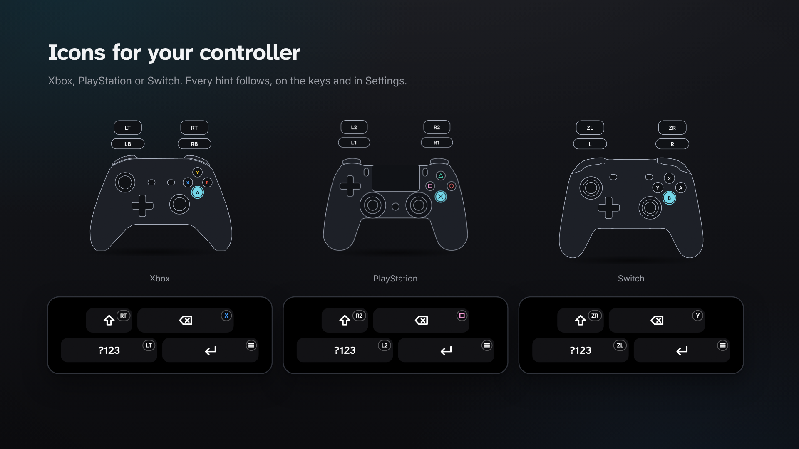

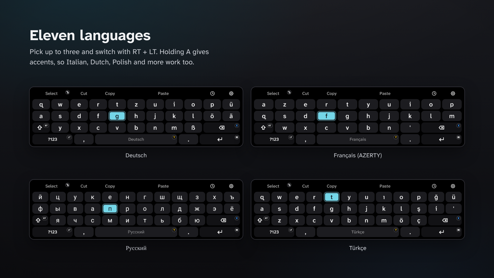

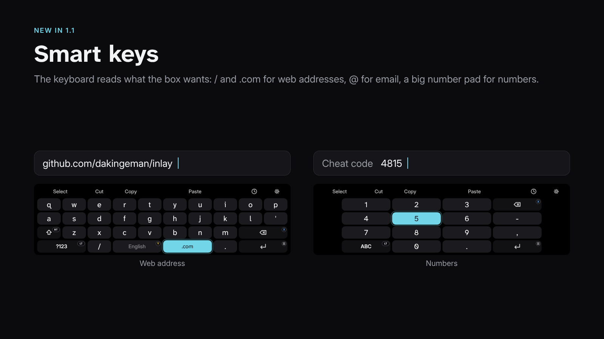

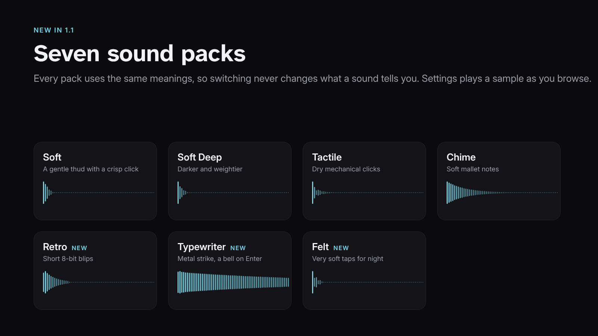

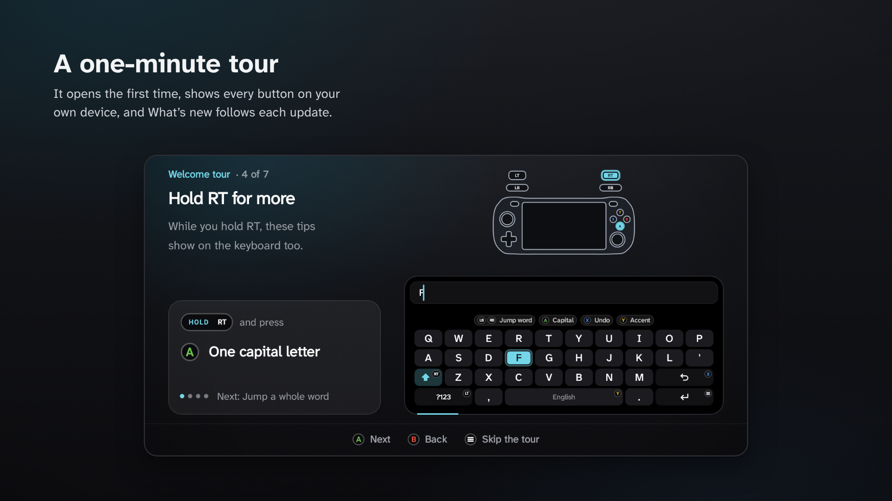

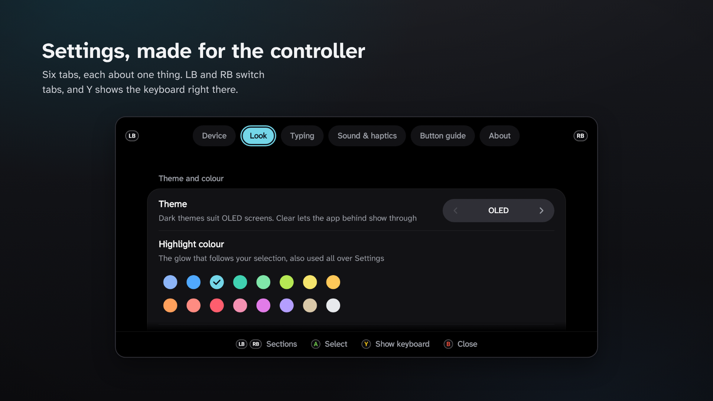

## Install

1. Download the latest `.apk` file from the [Releases](../../releases/latest) page onto your device.
2. Open it and allow installing from this source when Android asks.
3. Open **Inlay** and choose **About → Turn on Inlay**.
4. Choose **About → Switch keyboard** to make it the active keyboard.

A one-minute tour opens the first time, and you can replay it any time from **About**.

**Updates:** the free [Obtainium](https://github.com/ImranR98/Obtainium) app can watch this page and install new versions for you. In Inlay, choose **About → Get updates automatically**, or tap the Obtainium button at the top of this page on your device.

**Android TV or Google TV:** install the same `.apk` (for example with a file manager or "Send files to TV"), open **Inlay** from the apps row and follow the set-up card. TV mode turns on by itself there.

**Requirements:** Android 10 or newer, and a built-in controller or a connected gamepad.

## Features

| Feature | What it does |
|-|-|
| **Made for controllers** | D-pad or left stick moves the highlight the instant you press, with smart repeat when you hold a direction. A light stick push moves gently, a full push fast. |
| **Every button has a job** | A types, X deletes (hold to speed up), Y is space, Start is enter. LB and RB move the cursor, RT is shift, LT is symbols, and the right stick moves the cursor too. See [Controls](#controls). |
| **Hold RT for more** | Small tips appear on the keys: a capital letter, word jumps, accents and undo. Nothing to memorise. |
| **Edit text properly** | Select, cut, copy, paste and undo from the controller. Press Select twice to select everything. The right stick moves the cursor or grows a selection, faster the further you push (turn it off in Settings → Typing). |
| **Clipboard history** | Your last six copies, one button away. Anything marked as sensitive (passwords) is never kept. |
| **11 languages** | English, German, French (AZERTY), Spanish, Portuguese, Norwegian, Danish, Swedish/Finnish, Turkish, Russian and Ukrainian. Pick up to three and switch with RT + LT. RT + Y adds accents (é, ñ, ł and more), so Italian, Dutch, Polish and others work too. |
| **Smart keys** | / and .com in web addresses, @ in email boxes, a big number pad for numbers. |
| **TV mode** | A compact floating keyboard with a big line showing what you type, readable from the sofa. Turns on by itself when you dock. |
| **Make it yours** | 12 themes (including a see-through one), 16 highlight colours plus any custom colour, four highlight styles, three key shapes, two layouts, three sizes, and Xbox, PlayStation or Switch button icons. |
| **Seven sound packs** | Soft, Soft Deep, Tactile, Chime, Retro, Typewriter and Felt, with vibration tuned so even small motors are felt. |
| **Fits every screen** | Wide, 4:3, portrait or split screen. The keyboard never covers more than 60 % of the screen. |
| **A Settings app for the controller** | A live keyboard preview (press Y), the tour, a short What's new after each update, and your highlight colour all through it. |
| **Types straight into the app** | No full-screen typing box covering your game or launcher. |

## Controls

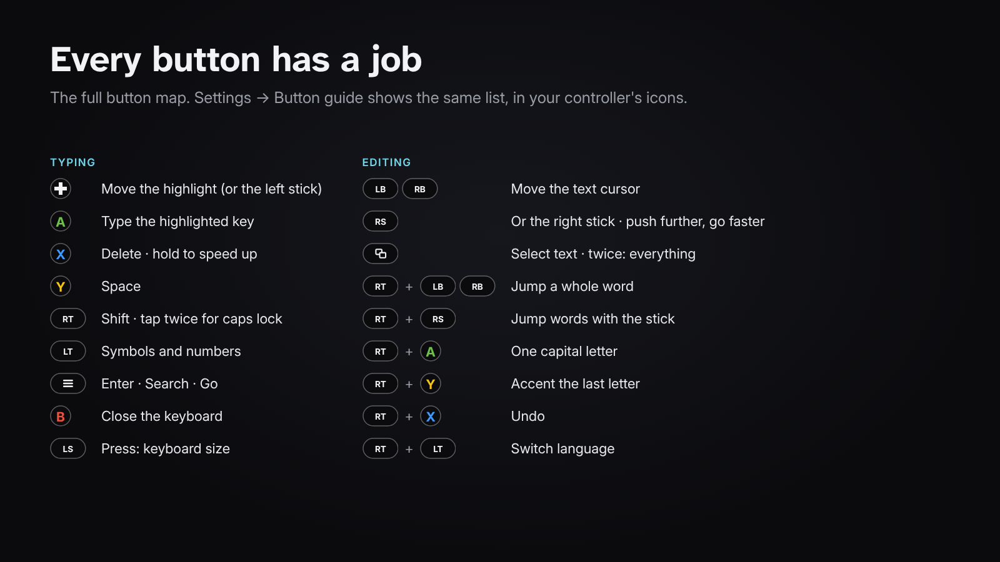

<b>The button map as text</b>

 

| Button | What it does |
|-|-|
| D-pad or left stick | Move the highlight |
| A | Type the highlighted key |
| X | Delete · hold to speed up, then whole words |
| Y | Space |
| RT | Shift · tap twice for caps lock |
| LT | Symbols and numbers (in number boxes: letters too) |
| Start | Enter · Search · Go |
| B | Close the keyboard · leave select mode or the clipboard |
| Press the left stick | Keyboard size: Normal, Large, Largest |
| LB / RB | Move the text cursor |
| Right stick | Move the text cursor, faster the further you push · up and down: a line, or the start or end |
| Select (View · Create · Minus) | Select text · press twice for everything |
| RT + LB / RB or RT + right stick | Jump a whole word |
| RT + A | One capital letter |
| RT + Y | Accent the last letter (e → é → è …) |
| RT + X | Undo |
| RT + LT | Switch language (when you've picked more than one) |

Settings → Button guide shows the same list in your controller's own icons, and leaves out anything you've switched off.

## Tested on

| Device | Android | Result |
|-|-|-|
| AYN Odin 2 Portal | 13 | Everything tested |
| AYN Odin 3 | 15 | Works ([reported by a user](../../issues/1)) |
| AYN Odin 3 Pro | – | Works (reported by a user on Reddit) |

Tried it on something else? Please [tell me how it went](../../issues/new/choose), even if it worked perfectly. That's how this list grows.

## Who made this

I'm Emre, and I don't write code. I want to say that plainly: every line of this app was written by Claude, Anthropic's AI. My part was the idea, deciding how it should look, feel and sound, and testing it on my AYN Odin 2 Portal, over and over, until it felt right. The sounds were made by Claude from scratch too, modelled on button sounds I picked out.

I'm sharing it to give something back to the community. There's no catch and nothing is for sale.

Since I can't read the code myself, I can't promise it's flawless, and I can only test it on my own device. If something goes wrong on yours, please open an issue and tell me what happened. If you can read code, improvements are very welcome.

## Build it yourself

Open the project in Android Studio and press **Run**. No extra libraries are needed. Before sending a change, have a look at [the update checklist](docs/UPDATING.md).

## Brand and credits

* The icon, colours and type are in [docs/brand](docs/brand/BRAND.md), with the rules for using them.
* Fonts: [Atkinson Hyperlegible Next](https://github.com/googlefonts/atkinson-hyperlegible-next) and [Inter](https://github.com/rsms/inter), both under the SIL Open Font Licence (see `licenses/`).
* All sounds were made for this project from scratch. The scripts that made them are in `tools/`.
* The 1.1 icon refresh followed the testing checklist from [logo-design-skill](https://github.com/kaankiziltug/logo-design-skill).

## Licence

GPL-3.0. See the [`LICENSE`](LICENSE) file.
