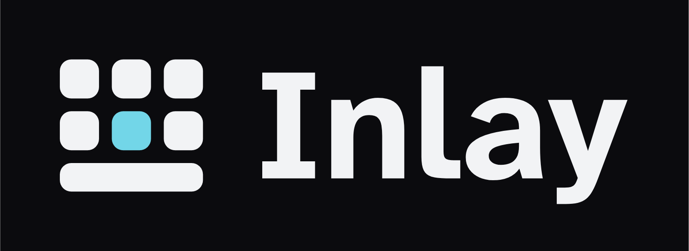

# Inlay brand kit

Everything needed to show Inlay consistently: the icon, the name, the colours and the type, with the rules that keep them looking right. How Inlay sounds is in [SOUND.md](SOUND.md).

## The idea

A small keyboard with one key lit: the key the highlight is on. That's how Inlay works (you move a highlight with the controller and press a button), so the icon shows exactly that and nothing more.

The 1.1 refresh keeps the original icon and tightens it:

| Change | Why |
|---|---|
| Fits inside a 62-unit circle on Android's 108-unit icon grid | Android's safe zone is 66. The 1.0 icon touched its edge, so round launcher masks could clip a corner |
| Gaps opened from 4 to 4.25 units | Light shapes on a dark tile look bigger than they are. Wider gaps keep the keys apart at small sizes |
| Space bar lower than a key (9.5 vs 13) | So it reads as a bar, not as a fourth row |
| One key size, one gap, one corner (radius = 29 % of a key) | The same corner as the app's default "Soft" keys |
| Whole group sits 0.5 unit above centre | The optical centre: a group that is exactly centred looks low |
| A small cut for 16–24 px | One row of keys plus the bar, with bigger shapes, so it stays clear when tiny |
| The teal is now the app's default highlight colour too | One teal everywhere: icon, README, keyboard |

Tests passed (from the logo-design-skill checklist): 16–128 px at real size, round and squircle masks, one colour black, one colour white, on white, the blur ("squint") test, and next to other apps on a home screen.

## Files

| File | Use |
|---|---|
| `inlay-icon.svg` · `png/inlay-icon-512.png` | The app icon on its tile. README, GitHub, store pages |
| `inlay-icon-small.svg` · `png/inlay-icon-small-48.png` | 16–24 px only (favicons, tiny badges) |
| `inlay-symbol.svg` | The symbol without a tile, on dark backgrounds |
| `inlay-symbol-on-light.svg` | The symbol on white (ink keys, deep teal key) |
| `inlay-symbol-black.svg` / `-white.svg` | One colour. The lit key becomes an empty slot |
| `inlay-lockup-dark.svg` / `-light.svg` | Symbol + name, for banners and headers |
| `inlay-wordmark.svg` | The name alone |
| `inlay-tv-banner.svg` | Android TV home-screen banner (also in the app as `tv_banner.xml`) |

## Colours

| Name | HEX | RGB | Use |
|---|---|---|---|
| **Ink** | `#0B0B0E` | 11 11 14 | Icon tile, dark backgrounds |
| **Paper** | `#F2F3F5` | 242 243 245 | Keys and text on dark |
| **Inlay teal** | `#72D6E8` | 114 214 232 | The lit key. The default highlight colour. 11.7 : 1 on Ink |
| **Deep teal** | `#1E8597` | 30 133 151 | The lit key on white (4.3 : 1). Plain teal on white is only 1.7 : 1, too faint |
| Graphite | `#1B1B1F` | 27 27 31 | Key colour in the app (OLED theme) |

Teal is the only colour with a meaning: "this is the one that's selected". Don't use it for decoration.

## Type

- **Atkinson Hyperlegible Next, Bold** for the name and headlines. The same family the keyboard letters use, made so similar letters never look alike. Free, SIL Open Font Licence (logo use allowed).
- **Inter** for longer text in images and mock-ups.
- The wordmark is drawn as shapes in the SVG files, so it looks the same everywhere without the font installed.

## Rules

- **Clear space:** keep at least one key width empty around the icon or lockup.
- **Minimum size:** the full icon down to 24 px; below that use the small cut. The lockup no narrower than 120 px.
- **Backgrounds:** dark lockup on Ink or dark photos; light lockup on white. Never put the plain teal key on white.

Don't:
- recolour the keys, or light more than one key
- add shadows, glows, outlines or gradients
- stretch, rotate or redraw the icon
- put the name in another font

## Voice

Plain and friendly, like a person explaining it to a friend. Short sentences, no hype, no capitals for emphasis. Say plainly that Claude wrote the code and Emre directed and tested it.
