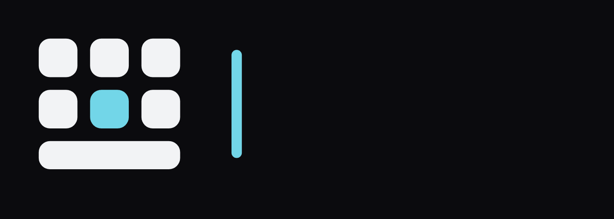

# Inlay brand kit

Everything needed to show Inlay consistently: the icon, the name, the colours and the type, with the rules that keep them looking right. How Inlay sounds is in [SOUND.md](SOUND.md).

## The idea

A small keyboard with one key lit: the key the highlight is on. That's how Inlay works (you move a highlight with the controller and press a button), so the icon shows exactly that and nothing more.

The 1.1 refresh keeps the original icon and tightens it:

| Change | Why |
|---|---|
| Fits inside a 62-unit circle on Android's 108-unit icon grid | Android's safe zone is 66. The 1.0 icon touched its edge, so round launcher masks could clip a corner |
| Gaps opened from 4 to 4.25 units | Light shapes on a dark tile look bigger than they are. Wider gaps keep the keys apart at small sizes |
| Space bar lower than a key (9.5 vs 13) | So it reads as a bar, not as a fourth row |
| One key size, one gap, one corner (radius = 29 % of a key) | The same corner as the app's default "Soft" keys |
| Whole group sits 0.5 unit above centre | The optical centre: a group that is exactly centred looks low |
| A small cut for 16–24 px | One row of keys plus the bar, with bigger shapes, so it stays clear when tiny |
| The teal is now the app's default highlight colour too | One teal everywhere: icon, README, keyboard |

Tests passed (from the logo-design-skill checklist): 16–128 px at real size, round and squircle masks, one colour black, one colour white, on white, the blur ("squint") test, and next to other apps on a home screen.

## Files

| File | Use |
|---|---|
| `inlay-icon.svg` · `png/inlay-icon-512.png` | The app icon on its tile. README, GitHub, store pages |
| `inlay-icon-small.svg` · `png/inlay-icon-small-48.png` | 16–24 px only (favicons, tiny badges) |
| `inlay-symbol.svg` | The symbol without a tile, on dark backgrounds |
| `inlay-symbol-on-light.svg` | The symbol on white (ink keys, deep teal key) |
| `inlay-symbol-black.svg` / `-white.svg` | One colour. The lit key becomes an empty slot |
| `inlay-lockup-dark.svg` / `-light.svg` | Symbol + name on their own ground (Ink / white), for banners and headers |
| `inlay-lockup-clear-dark.svg` / `-clear-light.svg` | The same with no ground, for the README and for laying over pictures |
| `inlay-wordmark.svg` / `-light.svg` | The name alone, on dark / on light |
| `inlay-wordmark-black.svg` / `-white.svg` | The name in one colour |
| `inlay-tv-banner.svg` | Android TV home-screen banner (also in the app as `tv_banner.xml`, checked to match by a test) |
| `motion/inlay-logo-typing-dark` / `-light` (.gif, .mp4) | The logo animation: the name typed out on the logo's keys |

All of these are generated by `tools/brand/kit.py` (files) and `tools/brand/logo_motion.py` (animation). Change the logo there, never by hand.

## The name: inlay|

Lowercase "inlay" in Atkinson Hyperlegible Next Bold with a text cursor resting after it, as if the word has just been typed. Chosen in October 2026 for 1.2, after rounds of options (a suggestion form "in|lay" with "lay" in grey was close, but in one colour the cursor reads as a second l: "inllay").

Every measurement is taken from the letters' ink, not their boxes:

| Part | Rule | Why |
|---|---|---|
| Cursor width | Half the n's stem (70 of 140 font units) | Clearly thinner than the letters, still 1.5 px wide at 24 px tall |
| Cursor gap | 77 units after the y: 0.8 × the gap between n and l | A touch closer than letters are to each other, so it belongs to the word |
| Cursor height | Baseline to the top of the l, plus 12 units at each end, ends fully round | Round ends look shorter than flat ones; 12 is how far the font's own round letters overshoot |
| Spacing | Bold letters 12 units tighter than the font's default | Big bold type looks loose at the default spacing |
| Crop | The files stop at the ink | The i's built-in side space is not part of the mark |
| Lockup | Symbol 1.25 × the l's height, centred on it; gap = one key + one key gap | The name sits like the next key in the row |

Readability: teal cursor on Ink 11.7 : 1, deep teal on white 4.3 : 1.

## Motion: the logo typing itself

The logo animation types the name on the logo's own keys, then rests as inlay| and loops. It's built from the same shapes, so any frame at rest is the logo.

| Part | How it moves | Why |
|---|---|---|
| Which key types which letter | i top middle, n middle right, l top right, a middle left, y the middle key | Worked out by laying the 3 × 2 keys over a real QWERTY keyboard: each letter takes the key nearest its real spot. The y is fixed on the middle key, so the loop ends where it began |
| The teal key | Hops to each key as it's pressed | Only ever one teal key, like the logo |
| The press | Down to 80 % at once, back over 200 ms with a 1 % spring past full size | The app's key press, made a touch deeper so it reads at logo size |
| The letter | Pushed down 3 % and back up over 110 ms, with a pale-teal glint gone in 160 ms | The letter answers the key. Light mode uses a stronger glint so it shows on black letters |
| Timing | Key, teal, letter and cursor change on the same frame | Checked on the rendered frames, all five letters |
| Rhythm | 307, 451, 235, 235 ms between letters | Same-hand letters come slower than a hand change (192 vs 147 ms, Ostry 1983), with a small beat at the syllable break in·lay (Pinet et al. 2016), played 1.6 × slower than real typing so it can be followed |
| Cursor | Blinks 530 ms on, 530 ms off, solid for 400 ms after every change | Android's own cursor blink |
| Loop | Rests about 2 s, the name is cleared right to left, and it starts again | 5.2 s in all; the first and last frames are identical |

For people who turn animations off, show the still lockup instead (it's the animation's resting frame).

## Colours

| Name | HEX | RGB | Use |
|---|---|---|---|
| **Ink** | `#0B0B0E` | 11 11 14 | Icon tile, dark backgrounds |
| **Paper** | `#F2F3F5` | 242 243 245 | Keys and text on dark |
| **Inlay teal** | `#72D6E8` | 114 214 232 | The lit key. The default highlight colour. 11.7 : 1 on Ink |
| **Deep teal** | `#1E8597` | 30 133 151 | The lit key on white (4.3 : 1). Plain teal on white is only 1.7 : 1, too faint |
| Graphite | `#1B1B1F` | 27 27 31 | Key colour in the app (OLED theme) |

Teal is the only colour with a meaning: "this is the one that's selected". Don't use it for decoration. On the README the badges are grey; teal is kept for the one "Download the APK" button.

## Type

- **Atkinson Hyperlegible Next, Bold** for the name and headlines. The same family the keyboard letters use, made so similar letters never look alike. Free, SIL Open Font Licence (logo use allowed).
- **Inter** for longer text in images and mock-ups.
- The wordmark is drawn as shapes in the SVG files, so it looks the same everywhere without the font installed.

## Rules

- **Clear space:** keep at least one key width empty around the icon or lockup.
- **Minimum size:** the full icon down to 24 px; below that use the small cut. The lockup no narrower than 120 px. The name alone no smaller than 24 px tall: below that the cursor gets thinner than about 1.3 px and fades, so use the symbol alone.
- **Backgrounds:** dark lockup on Ink or dark photos; light lockup on white. Never put the plain teal key on white.

Don't:
- recolour the keys, or light more than one key
- add shadows, glows, outlines or gradients
- stretch, rotate or redraw the icon
- put the name in another font, capitalise it, or drop or move the cursor
- animate the logo any other way than `logo_motion.py` does

## Voice

Plain and friendly, like a person explaining it to a friend. Short sentences, no hype, no capitals for emphasis. Say plainly that Claude wrote the code and Emre directed and tested it.
